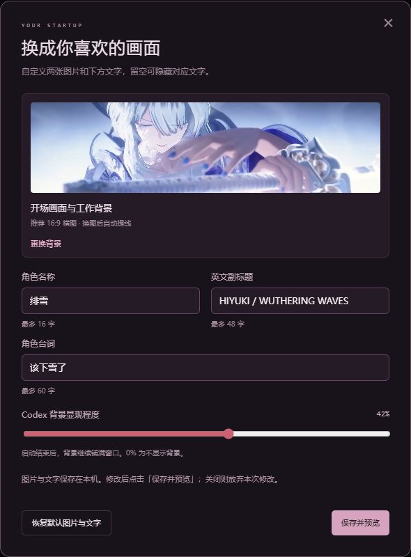

# 绯雪 · Codex 开屏动画（Windows）

给 Microsoft Store 版 Codex 添加 **13.5 秒绯雪主题开屏**：雪晶进场、人物描线、高清定格、连续挥刀、冰裂与渐隐，进入 Codex 后继续显示绯雪背景。

默认图片、台词与动作已经配好，安装后无需自己找素材。支持调整背景、角色名称、中文台词和背景显现强度。非官方个人美化项目，Codex 应用需要单独安装。


## 三步安装

适用于 **Windows 10/11 x64、Windows PowerShell 5.1、Microsoft Store 版 `OpenAI.Codex`**。普通使用不需要安装 npm、Python、Node.js 或 WebView2，也不需要管理员权限。安装器会检查 Codex 附带的 Node 运行时和 Windows 的 .NET Framework 编译器。

1. 在 [Releases](https://github.com/gongyikeshuaishuaida/codex-hiyuki-startup/releases/latest) 下载 `codex-hiyuki-startup-windows-v1.0.1.zip`，**完整解压**到一个准备长期保留的目录。
2. 双击 **`install.cmd`**。看到安装成功后，关闭这个安装窗口。
3. 保存当前工作，从托盘**完全退出 Codex**，再双击桌面的 **`Codex（绯雪开屏）`**。

也可使用 GitHub 的 **Code → Download ZIP** 下载源码包，完整解压后同样双击 `install.cmd`。不要直接在压缩包里运行，也不要只复制快捷方式给别人。

如果使用命令行安装，在项目目录运行：

```powershell
powershell.exe -NoProfile -ExecutionPolicy Bypass -File .\tools\install-windows.ps1
```

安装会在项目 `.build` 目录编译启动门控，并创建当前用户的桌面、开始菜单快捷方式；项目目录需要保留。移动目录后请重新安装。已有同名但指向其他目录的快捷方式时，安装器会提示处理，不覆盖不属于本目录的快捷方式。

## 设置成同款，或换自己的图片

双击 **`Codex（绯雪设置）`**，也可在从动画入口打开的 Codex 主窗口按 **Ctrl+Alt+B**。



- 默认就是本仓库演示的绯雪主题，无需导入配置。
- 以前安装过其他版本、仍显示旧图时：点击**恢复默认图片与文字**，再点击**保存并预览**。
- 可修改角色名称、台词、头像和背景强度。图片保存在本机，不上传到仓库。
- 更换整张背景后会切换为该图片的静态描线展示，停用默认绯雪专属的连续挥刀，避免动作与自选图片不一致。恢复默认素材即可恢复挥刀。
- 浏览器预览与应用内设置分别保存。在浏览器换图不会自动修改 Codex 内的设置。

双击 `index.html` 可以离线预览。预览页不会打开 Codex。

## 常见问题

**点官方图标没有开屏？** 请用安装器创建的 `Codex（绯雪开屏）`。这个项目没有修改官方安装包，也没有给所有启动方式加监听。

**提示先退出应用？** 从托盘完全退出 Codex 后重试。已运行且没有开放本地页面接口的实例无法直接接入。

**安装失败或文件不完整？** 先完整解压，再运行 `check.cmd`；它只检查环境与文件，不安装、不重启 Codex、不修改快捷方式。不要把账号、令牌或聊天记录上传到问题反馈中。

**Codex 更新后失效？** 重新安装以检查新的应用目录。上游应用的窗口或页面结构更新可能需要修改本项目，不能保证所有未来版本都兼容。

**想停用？** 完全退出 Codex，之后从官方图标启动。可删除本项目的桌面与开始菜单快捷方式；不创建开机任务或登录监听。

**有配乐吗？** 实际开屏默认无声。此前展示短片的抖音配乐不属于安装功能，也未放进本仓库。

## 技术范围与验证

- 默认动作素材有效尺寸为 **1920×1080 / 30 帧**。动画画布为 2560×1440；画布尺寸不代表每个素材都是原生 2K。
- 高清定格和连续动作取自同一个原生镜头，保留完整挥刀后的眼部特写及冰雪爆发。
- 启动时等待素材解码、预热，再显示开屏。启动总耗时还包含官方 Codex 本身加载时间。
- 启动器使用 `127.0.0.1:19341` 的本地接口临时载入动画和背景，并核对接口所属进程；不要将此端口转发到公网。
- 如本机已有 `~/.codex/.env`，启动脚本仅使用其中代理相关变量；本仓库不附带个人代理、账号、Cookie 或登录状态。
- 状态与错误日志位于 `%LOCALAPPDATA%\OpenAI\ChatGPTFix`。
- 发布前检查包含文件哈希、全新路径解压、Windows PowerShell 语法、门控编译、页面预览、注入与设置检查。**浏览器测试不等同于另一台电脑实际启动成功**；他人电脑的应用版本、硬件及策略仍以实测为准。

开发者可使用 Node.js 22 或以上。Windows 的浏览器检查使用系统 Microsoft Edge，验证与应用一致的 H.264 高清动作解码；Playwright 的精简浏览器不一定带有该解码器：

```powershell
npm ci
npm test
npx playwright install chromium
npm run test:browser
```

## 来源与使用范围

Windows 接入基于 [yanami-sec/codex-startup-animation-windows](https://github.com/yanami-sec/codex-startup-animation-windows)，保留其来源以及更早上游说明。精细光构和路径表现参考 [chenyi380/baili-codex](https://github.com/chenyi380/baili-codex)、[mytjxs/codex-startup-animation](https://github.com/mytjxs/codex-startup-animation)。

绯雪角色及原始美术、视频归库洛游戏及各自权利人；本仓库用于个人主题展示，不宣称拥有角色素材版权，不授权第三方商用。没有将上游未注明许可证的代码改标为 MIT。详见 [THIRD_PARTY_NOTICES.md](THIRD_PARTY_NOTICES.md) 和 [素材来源](docs/ASSETS.md)。
